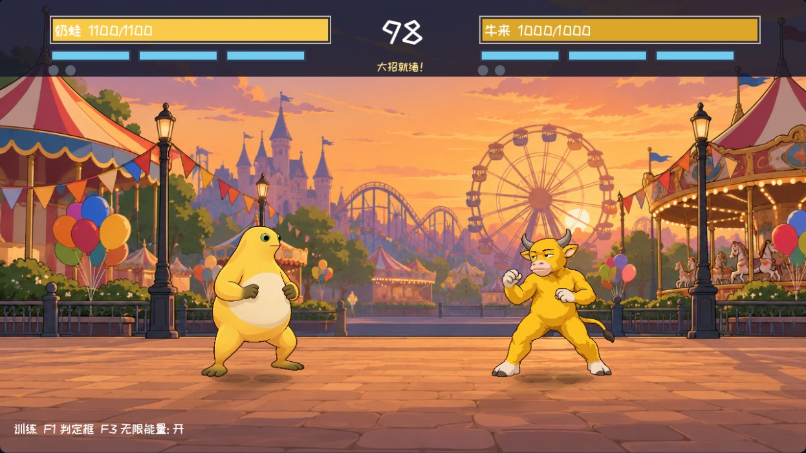
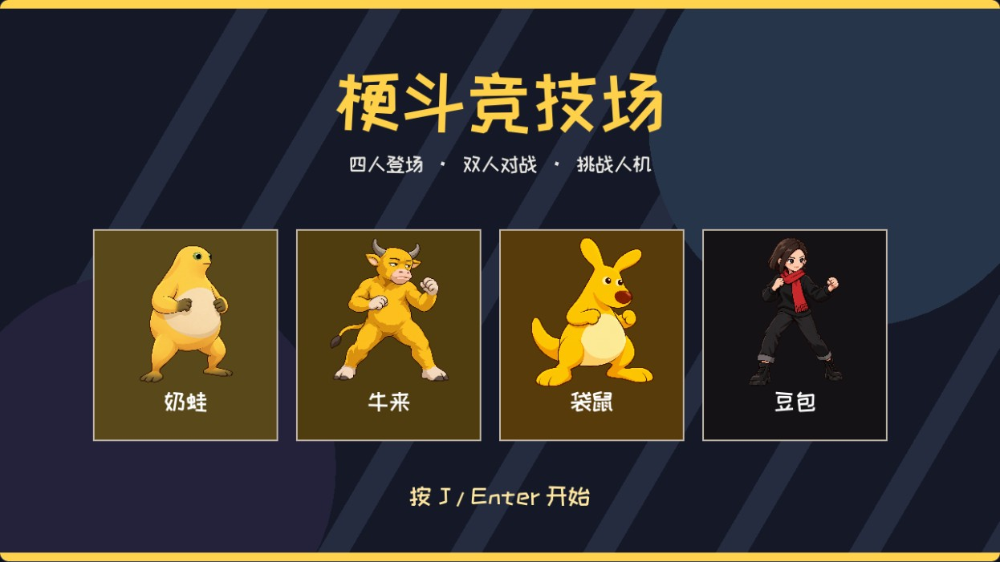
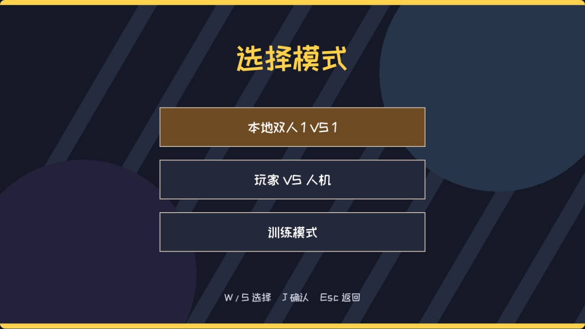
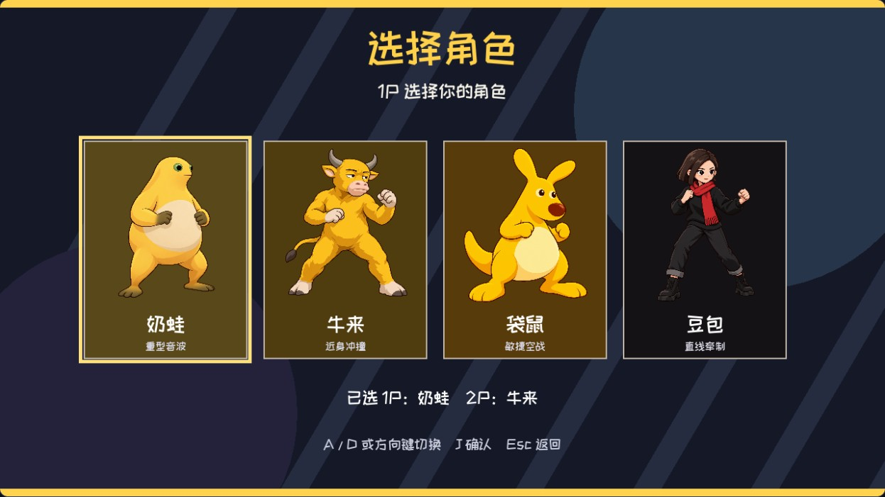
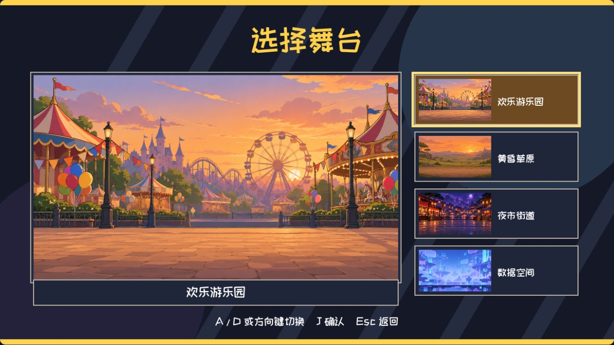
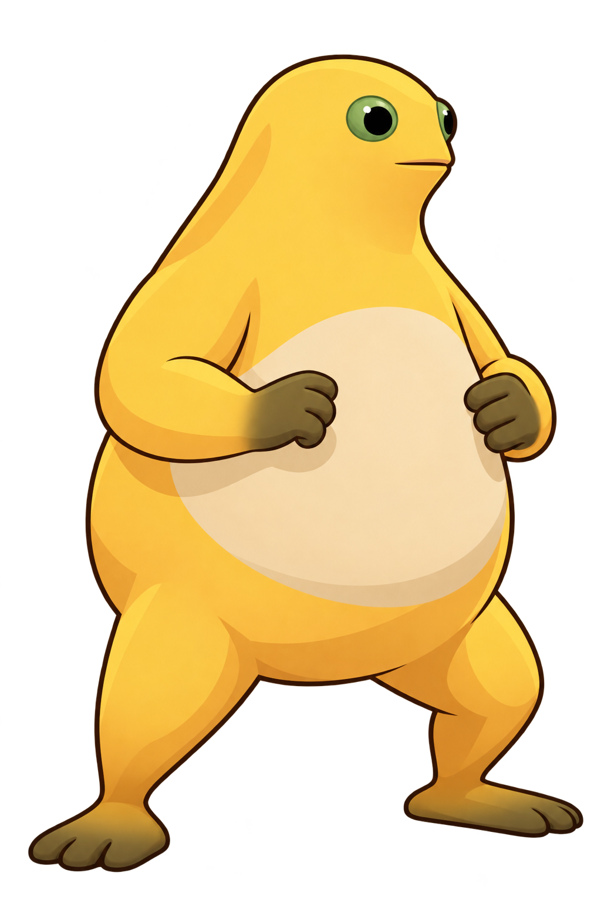
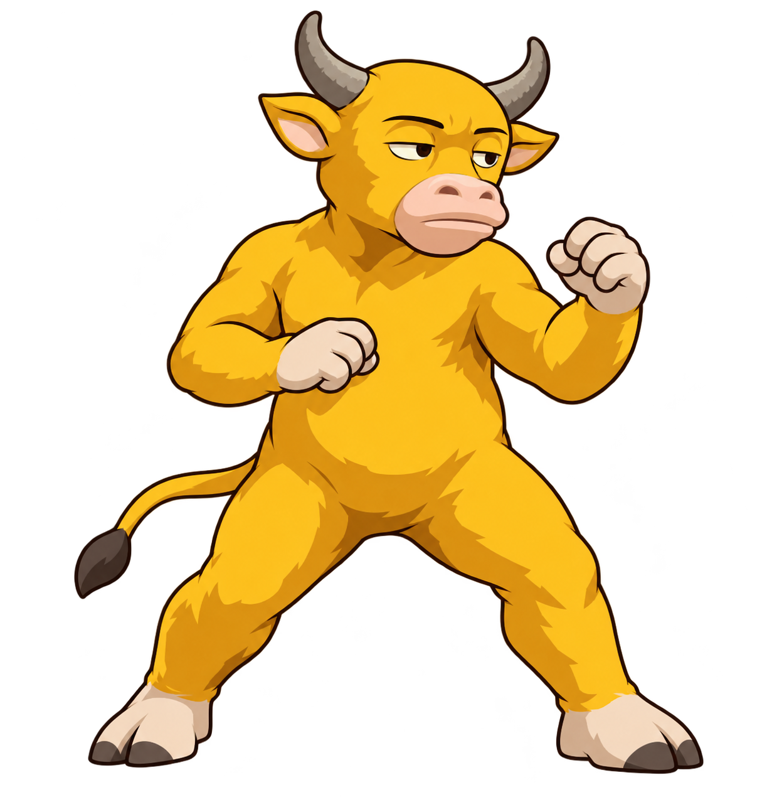
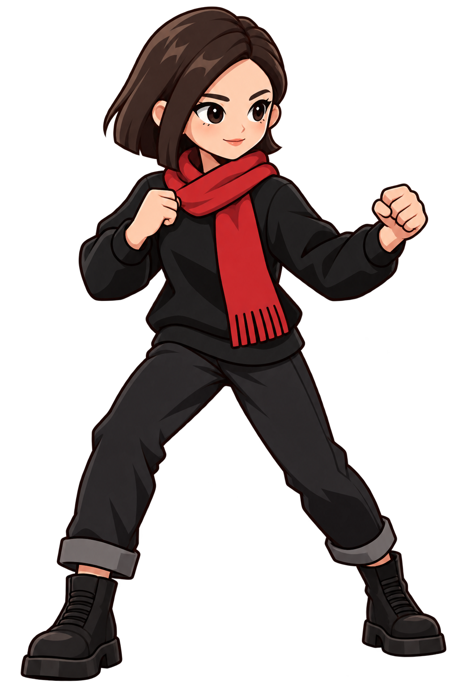
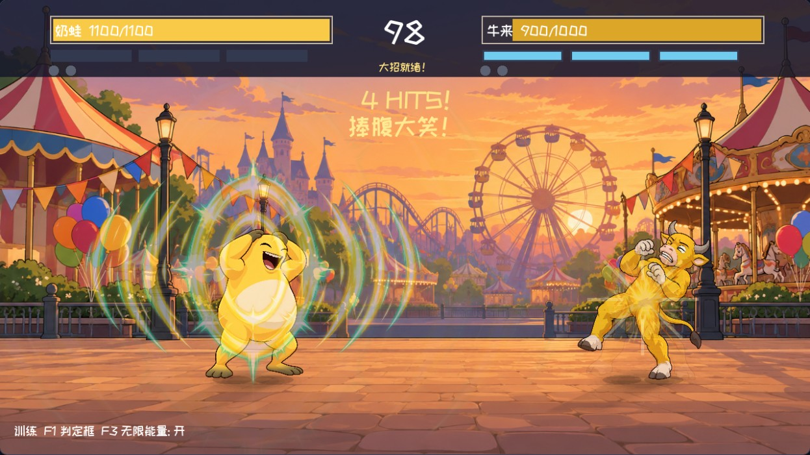

<div align="center">

# 梗斗竞技场

**奶蛙、牛来、袋鼠、豆包，在同一个擂台上正面交锋。**

受街机和网页格斗游戏启发的 **2D 横版格斗游戏** · Godot 4.6.3 · GDScript

[](https://github.com/xingyuliu586-tech/gengdou-arena/actions/workflows/pages.yml)
[](https://xingyuliu586-tech.github.io/gengdou-arena/)

### 🎮 [点击这里，直接在浏览器游玩](https://xingyuliu586-tech.github.io/gengdou-arena/)

[下载完整源码](https://github.com/xingyuliu586-tech/gengdou-arena/archive/refs/heads/main.zip) · [工程修改指南](先看这里_工程修改说明.md) · [提交问题](https://github.com/xingyuliu586-tech/gengdou-arena/issues)



*实机画面：奶蛙对阵牛来。上方显示双方血量、能量、回合胜点和剩余时间。*

</div>

<details>
<summary>查看游戏标题画面</summary>



</details>

## 这是什么游戏？

玩家从四名角色中自由选人，进行一对一格斗。除了普通出拳，还可以跳跃、飞踢、冲刺、防御、衔接普攻，以及释放方向技能和角色专属大招。

- **本地双人**：两人共用一台电脑、一副键盘对战，允许双方选择同一角色。
- **人机对战**：电脑会主动接近并进攻，有简单、普通、困难三档。
- **训练模式**：对手作为木桩，用来练招、查看判定和测试大招。
- **四张舞台**：欢乐游乐园、黄昏草原、夜市街道、数据空间。
- **回合规则**：每局 99 秒，默认三局两胜；攻击、受击和防御可以积累能量，大招需满 300 能量。

这是持续开发中的可玩原型。当前动画由角色关键姿势和程序补间组成，后续还可补充更密的逐帧图、正式大招演出与平衡调整。

## 怎么开始玩？

1. 打开 **[在线游戏](https://xingyuliu586-tech.github.io/gengdou-arena/)**，点击网页上的“开始游戏”。首次需要下载资源，等待加载完成。
2. 点击游戏画面，让画面获得键盘焦点，并启用声音。
3. 按 **J 或 Enter**进入菜单，选择模式，再依次选择双方角色。
4. 人机模式还需选择难度，之后选择舞台并确认，出现 FIGHT 后开打。

**建议使用电脑上的 Chrome、Edge 或 Firefox，并用键盘操作。** 当前没有手机触控按键；“双人”指同一台电脑的本地对战，目前没有跨电脑联网对战。

### ① 选择玩法



*想与朋友对打，选本地双人；一个人玩，选人机对战；想练大招，选训练模式。*

### ② 自由选择双方角色



*先选 1P，再选 2P 或电脑角色。双方可以选同一人；同角色对战时，2P 会使用区分颜色。*

### ③ 选择舞台



*每张卡片展示对应场景的背景图，确认后进入这张舞台。*

## 四名角色和专属大招

<p align="center">
  
  
  
  
</p>

### 奶蛙 · 重型音波

黄色圆身体、浅色大肚皮、绿色眼睛。大招 **「捧腹大笑」** 进入大笑动作，连续释放全屏音波，再接最后一波爆发，并以笑后伸掌收势。音波可防御。



*奶蛙大招实机截图。动作包含捧腹笑、抱头笑、笑倒与笑后动作，参考了提供的角色图片和视频。*

### 牛来 · 近身冲撞

金黄色双足牛、灰色牛角、粉色口鼻。大招 **「妈妈！冲撞」** 在喊声后向前横贯场地，撞击途经的敌人；对手可以防御或跳跃躲避。

### 袋鼠 · 敏捷空战

黄色圆身体、长耳朵、大棕鼻子和尾巴。大招 **「雷霆大坐」** 配合“你的胆子真是肥嘟嘟的！”语音，直接飞向敌人并坐下，落地带冲击和扬尘。此招不可防御，不带闪电。

### 豆包 · 直线牵制

深棕短发、黑衣黑裤、红围巾。大招 **「最直白的一击」** 完整显示“我将用最直白最不绕弯子的办法干掉你”，然后朝前方发出重击光束；可防御或跳跃躲避。光束从拳头位置沿角色朝向发射。

> 奶蛙、牛来、袋鼠已接入指定视频截取的大招语音；豆包目前以字幕呈现台词。四个大招均有判定、伤害和现阶段演出，正式动画仍可继续精修。

## 键盘操作

### 1P

- **A / D**：左右移动；**K**：跳跃；**L**：冲刺。
- **S**：按住防御；按住 S 再按后退方向，可缓慢后撤。
- **J**：普通攻击，可连续输入衔接连段。
- **W + J**：上挑；**S + J**：下段；跳跃中按 J：空中攻击。
- **U**：普通技能；**W + U**：向上技能；**S + U**：贴地技能。
- **I**：能量满 300 后释放大招。

### 2P

- **← / →**：左右移动；**↓**：按住防御；**2**：跳跃；**3**：冲刺。
- **1**：普通攻击；**↑ + 1**：上挑；**↓ + 1**：下段。
- **4**：普通技能；**↑ + 4**：向上技能；**↓ + 4**：贴地技能。
- **5**：满能量后释放大招。数字键同时支持主键盘数字区和小键盘。

### 菜单、暂停和训练

- 方向键或 W / A / S / D：菜单切换；**J / Enter**：确认；**Esc**：返回。
- 对战中 **Esc**：暂停或继续；暂停时 **Q**：返回标题。
- **F1**：显示或隐藏判定框；训练模式中 **F3**：切换无限能量。

## 下载源码，自己修改

本仓库就是可编辑的完整 Godot 工程，包含代码、场景、PNG 美术、字体、音频、参考图和交接文档。

1. 点击仓库的 **Code → Download ZIP**，或使用上方的“下载完整源码”链接。
2. **解压整个压缩包**，保留文件夹结构。
3. 使用 **Godot 4.6.3 标准版**，在项目管理器中选择“导入”，选中 `project.godot`。
4. 首次打开时等待资源导入完成，按 **F5** 运行。

也可以用 Git 克隆：

```sh
git clone https://github.com/xingyuliu586-tech/gengdou-arena.git
```

游戏运行不依赖 .NET、Python 或额外 Godot 插件。`tools/` 中的 Python 脚本仅用于重新生成部分音频素材。

### 从哪里改？

```text
project.godot                     工程设置和启动入口
scenes/格斗主场景.tscn             游戏主场景
scripts/main.gd                   战斗、输入、人机、界面与绘制
scripts/ultimate_presentation.gd   大招切入和台词字幕
assets/characters/                四名角色的动作关键图
assets/stages/                    四张舞台背景
assets/effects/                   音波、光束、冲撞、打击等特效
assets/audio/                     背景音乐、打击和大招音效
assets/fonts/                     游戏字体
reference/                        角色原始参考图
docs/                             角色设定、动画与音频交接文档
web/shell.html                    网页加载界面和全屏按钮
.github/workflows/pages.yml       自动构建和发布 GitHub Pages
```

当前实现主要由 `main.gd` 维护战斗状态并绘制角色。改伤害、速度、攻击范围和人机行为，可以从这个文件入手；制作正式大招动画时，同时查看 `ultimate_presentation.gd` 和大招交接文档。

- [工程修改说明](先看这里_工程修改说明.md)：打开步骤、常见函数入口与需要保留的修复。
- [试玩说明](试玩说明.md)：完整按键和当前完成范围。
- [角色视觉设定](docs/character_bible.md)：四人的外形与参考图。
- [动作时间线](docs/animation_timeline.md)：普攻节奏和关键姿势补间方式。
- [大招动画交接](docs/ultimate_handoff.md)：台词、动作概念、判定和演出衔接。
- [音频来源说明](docs/audio_sources.md)：大招语音与背景音乐来源。

## 发布自己的网页版本

这个仓库已启用 GitHub Pages。修改后推送到 `main`，GitHub Actions 会自动导入资源、导出 Web 游戏并更新在线网址。[点击查看构建状态和日志](https://github.com/xingyuliu586-tech/gengdou-arena/actions)。

本地测试网页版，需要先安装 Godot 4.6.3 的 Web 导出模板，再使用编辑器中的 Web 预设导出，或运行：

```sh
godot --headless --editor --path . --import
mkdir -p builds/web
godot --headless --path . --export-release Web builds/web/index.html
python -m http.server 8000 --directory builds/web
```

浏览器访问 `http://localhost:8000`；直接双击导出的 HTML 无法正常加载游戏资源。

## 遇到问题

- **没有声音或按键没反应**：先点击游戏画面，让浏览器启用音频和键盘输入。
- **一直加载或加载失败**：检查网络，刷新页面，并尝试新版 Chrome、Edge 或 Firefox。
- **大招按键无反应**：先确认能量是否达到 300；可在训练模式测试无限能量。
- **反馈游戏问题**：在 [Issues](https://github.com/xingyuliu586-tech/gengdou-arena/issues) 描述角色、模式、触发步骤和浏览器，附上截图方便定位。

素材和用户提供音轨的来源见 `docs/`；本仓库没有为参考角色、音乐或其他素材授予额外使用许可。
